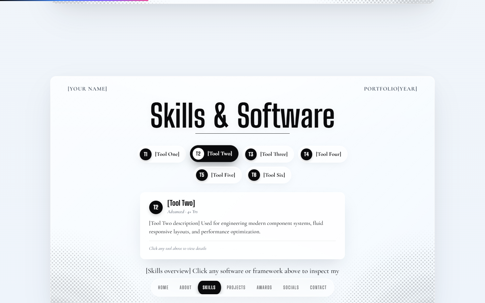
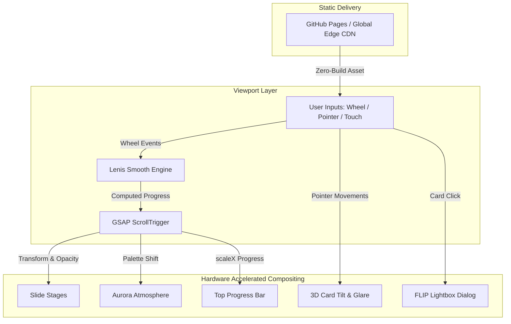

# goatedd-sPortfolio

<p align="center">
  <strong>An editorial-grade, buildless interactive slide portfolio engineered for silky-smooth 120+ FPS performance, fluid kinetic typography, and reactive 3D micro-interactions.</strong>
</p>

<p align="center">
  <a href="https://goateddhleminh.github.io/goatedd-sPortfolio/"></a>
  
  
  
</p>

<p align="center">
  
</p>

<p align="center">
  <a href="https://goateddhleminh.github.io/goatedd-sPortfolio/"><strong>Explore Live Experience</strong></a> •
  <a href="#system-architecture--technology-stack"><strong>System Architecture</strong></a> •
  <a href="https://github.com/goateddhleminh/goatedd-sPortfolio/issues"><strong>Report Issue</strong></a>
</p>

---

## ⚡ Core Highlights

- **Buttery 120+ FPS Inertial Scrolling**: Powered by Lenis smooth-scroll tuned to an Apple-standard exponential decay curve (`duration: 0.95`, frame budget `<6ms`), coupled frame-by-frame with GSAP ScrollTrigger to eliminate lag and layout judder.
- **Atmospheric Multi-Layer Aurora Stage**: GPU-accelerated procedural ambient glow that dynamically tint-shifts based on scroll depth, isolated via hardware compositing layers (`translate3d`, `contain: layout style paint`) to keep fill rates optimal.
- **Perspective 3D Cards & FLIP Lightbox**: Mouse-reactive perspective tilt and specular glare running with cached bounding geometry to prevent layout thrashing, expanding seamlessly into an inspect dialog via FLIP geometry tweening.
- **Interactive Credential Drawer**: Expandable inspection drawers for technical certifications and academic credentials (IELTS 7.5, MOS World, MOS Excel) with bidirectional toggling and complete keyboard accessibility.
- **Kinetic Floating Dock**: Bottom glassmorphic navigation bar with real-time viewport intersection monitoring, magnetic hover physics, and safe-area adaptation.
- **Zero-Build, Pure Web Native**: Fully self-contained architecture requiring no Node compile step, no bundle bloat, and no hydration delays, resulting in sub-300ms First Contentful Paint.

---

## 🛠️ System Architecture & Technology Stack

| Layer | Technologies | Purpose |
| :--- | :--- | :--- |
| **Foundation** | HTML5, Modern Vanilla JS (ES2023+), Modern CSS3 | Single-file zero-build runtime, Container Queries, OKLAB color mixing |
| **Motion Physics** | GSAP 3.12 + ScrollTrigger | Timeline orchestration, reveal staggers, and FLIP dialog transforms |
| **Scroll Engine** | Lenis 1.1 | Virtual inertial momentum, high-refresh display pacing |
| **Styling & Shaders** | Modern Glassmorphism & Custom Properties | Frosted glass backdrops, dynamic radial aurora fields |
| **Edge Hosting** | GitHub Pages, Vercel Edge Network | Automated static deployment and edge caching |



---

## 🚀 Quick Setup (< 60 Seconds)

### Prerequisites
- Any modern desktop or mobile browser (Chrome 110+, Edge 110+, Safari 16.4+, Firefox 115+)
- Optional: `git` and a lightweight local HTTP server

### Installation & Execution

```bash
# 1. Clone repository
git clone https://github.com/goateddhleminh/goatedd-sPortfolio.git

# 2. Enter directory
cd goatedd-sPortfolio

# 3. Launch local static server (choose any preferred method)
# Using Python:
python -m http.server 3000

# Or using Node:
npx serve .

# Or open directly in your default browser:
open index.html
```

---

## ⚙️ Configuration Reference

All personal information, featured projects, and animation tuning parameters are exposed in the declarative `CONFIG` object inside `index.html`:

| Variable / Parameter | Type | Purpose | Default Value |
| :--- | :--- | :--- | :--- |
| `CONFIG.name` | `string` | Display name featured across hero and header | `"Huynh Le Minh"` |
| `CONFIG.year` | `string` | Portfolio active release edition tag | `"2027"` |
| `CONFIG.role` | `string` | Professional discipline headline | `"Creative Developer"` |
| `CONFIG.projects` | `object[]` | Collection of interactive project showcase items | Array of project objects |
| `BG_CONFIG.cursorSmoothing` | `number` | Ambient cursor glow lerp duration (seconds) | `0.25` |
| `BG_CONFIG.scrollShift` | `boolean` | Enables scroll-driven background palette shifts | `true` |

---

## 📂 Project Directory Structure

```
goatedd-sPortfolio/
├── assets/                     # Media artwork and visual showcases
│   ├── ashen-veil.png          # ARPG gameplay cover
│   ├── preview.png             # Desktop hero preview image
│   ├── tidewrought.png         # Idle pixel game cover
│   └── virtue.png              # Study tracker UI cover
├── index.html                  # Self-contained core application (HTML, CSS, JS)
└── README.md                   # Technical blueprint and project documentation
```

---

## 🗺️ Roadmap & Milestones

- [x] High-efficiency 120+ FPS animation pipeline with Lenis & GSAP
- [x] Interactive 3D tilt with cached bounds to eliminate layout reflow
- [x] FLIP modal transition for project deep-dives
- [x] Dynamic certification inspector (IELTS 7.5 Academic, MOS World & Excel)
- [x] Showcase projects: Virtue Planner, Ashen Veil ARPG, Tidewrought RPG
- [ ] Adaptive light/dark palette mode toggle
- [ ] Procedural WebGL background particle integration
- [ ] Bilingual localization support (English / Vietnamese)

---

## 🤝 Contributing

Contributions and feedback are welcome!
1. Fork the project repository.
2. Create your feature branch (`git checkout -b feature/enhancement`).
3. Commit your modifications (`git commit -m 'Add new feature'`).
4. Push to your branch (`git push origin feature/enhancement`).
5. Open a Pull Request detailing the changes and performance impact.

---

## 📄 License

Distributed under the MIT License.
